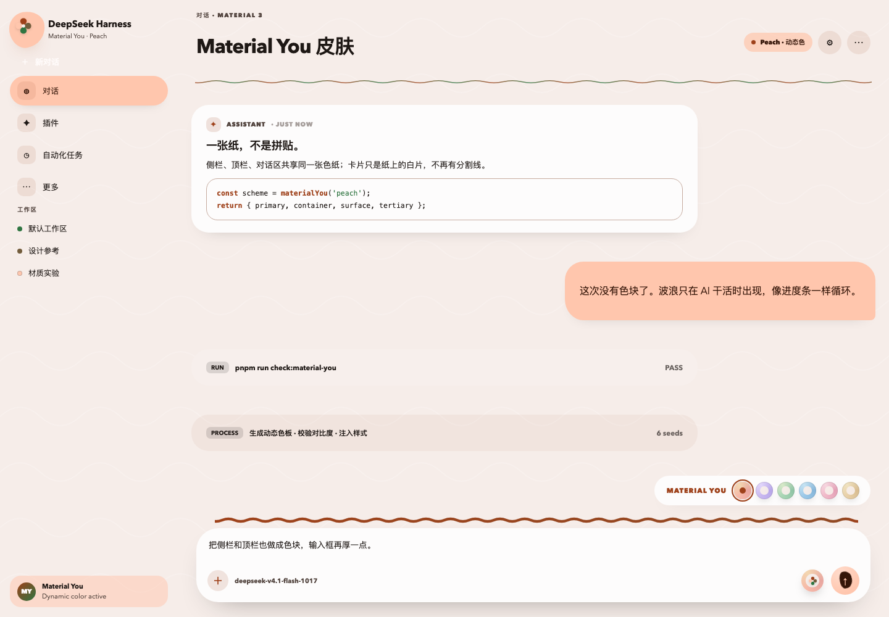
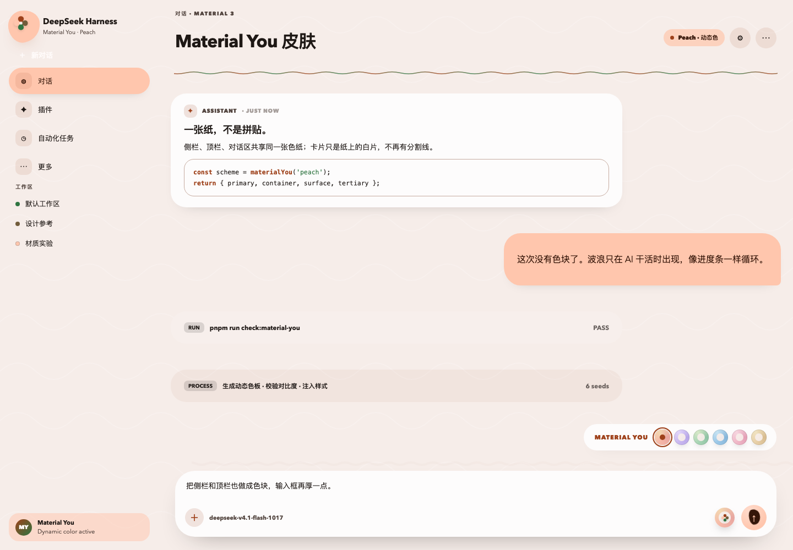
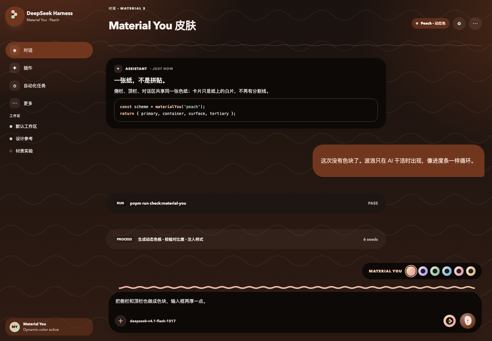
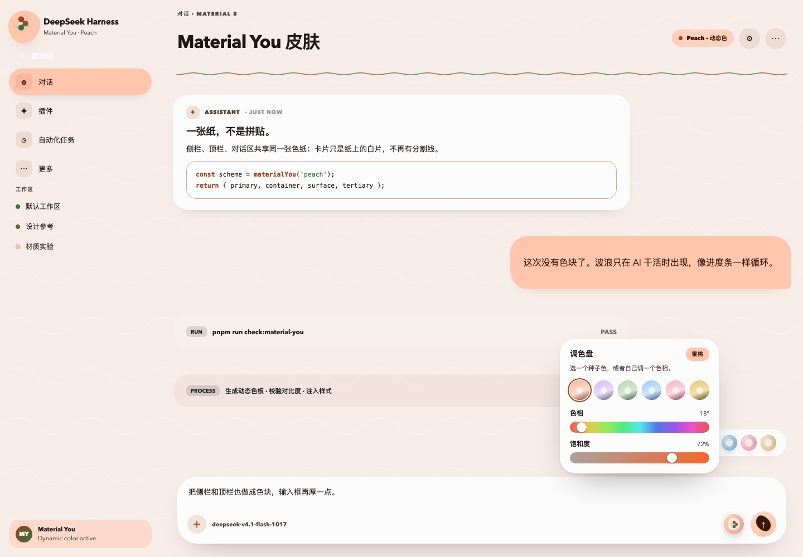
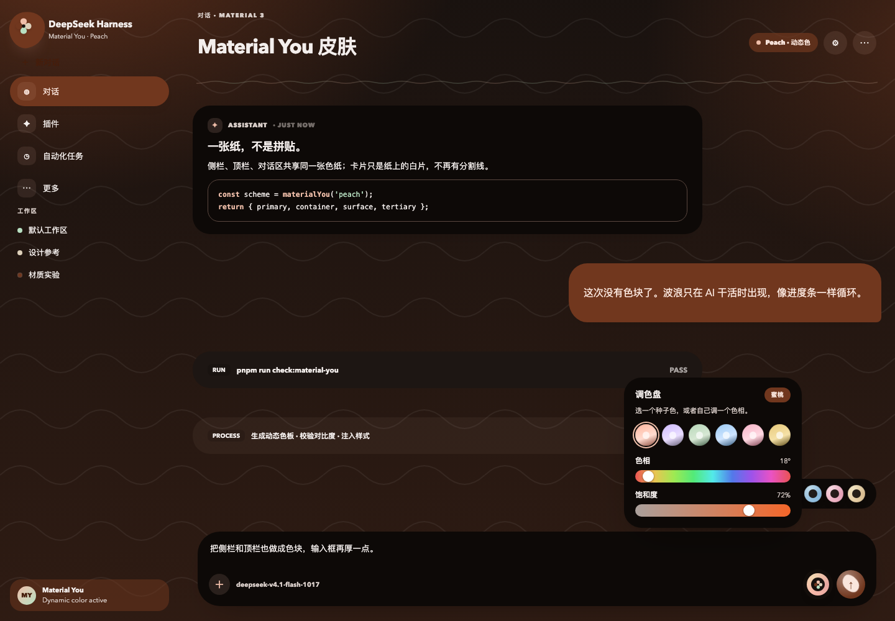

# Material You Skin for DeepSeek Harness

An expressive Material 3 / Material You skin for the DeepSeek Harness Web GUI: one continuous tonal field, paper cards, a wave progress line and a two-tone expressive send button.

Built and tested against DeepSeek Harness `0.2.1-rc.3` (web surface).



---

## What you get

- **Dynamic color from six seeds** — Peach, Lavender, Sage, Ocean, Rose, Sand. Every role is derived from the seed, never hand-picked per component.
- **One sheet, no seams** — the sidebar, header, chat and composer share a single painted surface. No dividers, no contrasting bands, no floating panels.
- **Tonal paper cards** — elevation is expressed by surface tone and a soft lift, not by borders.
- **Wave progress line** — while the model is working, a wavy ribbon grows from 0 to 100% along a faint straight track above the composer, then starts over. The wave keeps undulating as it fills. At rest the whole line disappears. A separate, always-on thin wave sits under the conversation header.
- **Expressive send button** — a tonal disc holding one dark shape that keeps morphing: it tilts, stretches into an oval, rounds into a blob and settles back, on a 6-second loop. Never a static icon.
- **A real palette** — the button beside the composer opens a palette panel: six seeds, plus hue and saturation sliders for a custom color. The whole interface re-tones live as you drag.
- **Light and dark**, `prefers-reduced-motion` respected, all labels localized (English and Chinese).

| Light, idle | Dark, working |
| --- | --- |
|  |  |

| Palette, light | Palette, dark |
| --- | --- |
|  |  |

---

## Install

The skin is a DSH **bundle**: a package that declares `dsh.bundle.patch` and `dsh.client`, plus a `cordis.patch.yml` that inserts its own row.

```sh
git clone https://github.com/HaoRangQi/dsh-material-you-skin.git
```

Then install that directory as a bundle into your profile — with the plugin manager, or by hand:

```jsonc
// <profile>/package.json
{
  "dependencies": {
    "@local/material-you-skin": "link:/absolute/path/to/dsh-material-you-skin"
  },
  "dsh": {
    "profile": {
      "bundles": ["@deepseek-ai/dsh-base", "@deepseek-ai/dsh-web-app", "@local/material-you-skin"]
    }
  }
}
```

The bundle's own patch adds the row, so you do not edit `cordis.patch.yml` yourself:

```yaml
- insert:
    - id: ui-skin-material-you
      name: '@local/material-you-skin'
```

**Enable it, then reload.** Enabling a client plugin only changes the profile composition; the running renderer has already booted its module list. Press `Cmd+R` (or restart the app) to load `client.js`. After that, seed, motion and ambient changes are live and need no reload.

### Uninstall

Disable or remove the `ui-skin-material-you` row. The skin never calls `setTheme`, so your previous theme returns untouched.

---

## Design research

Material You is the expressive branch of Material Design 3. The parts that matter for a desktop workbench, rather than a phone home screen:

| Principle | What it means here | How this skin expresses it |
| --- | --- | --- |
| Dynamic color | One seed color generates a tonal palette; every role is derived, never hand-picked per component. | Six seeds, each producing light and dark role maps consumed through `--m3-*` and `--dsw-alias-*` tokens. |
| One continuous field | The reference images are a single colored sheet with cards resting on it, not a patchwork of sidebars and headers. | The document itself carries one flat tone — no gradients, no tinted blobs. Every shell column is transparent. Cards are the only "paper" on top. |
| Tonal cards | Elevation is communicated by surface tone, not heavy borders or drop shadows. | Cards, tool rows and process rows share one near-white / near-black paper stock with a subtle primary tint. |
| Organic underlays | The reference language is soft and wavy, not a grid of rectangles. | A faint wavy contour runs through the field; the composer carries the wave progress line. |
| Expressive shape | Large corner radii, pills for navigation and actions, 28–40px sheets. | Sidebar rows and buttons are full pills; chat rows use 28–32px corners; the composer is a 36–40px capsule. |
| State layers | Hover / focus / press are tonal overlays at fixed opacities. | `color-mix()` hover and active layers, a primary-container active-nav pill, a 5–6px focus halo, and a pointer ripple. |
| Typography | Friendly, rounded, high-contrast scale. | Rounded system stack (`SF Pro Rounded`, `Google Sans`, `Nunito`), 25–30px titles, tighter display tracking. |
| Motion | Short, choreographed, meaningful. | 180/320/520 ms durations, emphasized easing, springy press scale, composer focus lift; all disabled under `prefers-reduced-motion`. |
| Adaptive | The same language works across densities. | All rules are token-driven and scoped to `body[data-m3-skin]`; no fixed pixel layout replaces the shell's own grid. |

Reference points: Material 3 color roles and tonal palettes, the M3 shape scale, M3 state layers, and the Material You "dynamic color from a seed" model.

---

## Implementation

**Bundle shell** — `package.json` (`dsh.bundle.patch`, `dsh.client`), `cordis.patch.yml`, a no-op host `index.js`, locale metadata, and an original four-petal icon.

**Client half** — one `client.js` that:

1. registers `en` / `zh` dictionaries through `ctx.locale`;
2. overlays the complete `--dsw-alias-*` role set plus a custom `--m3-*` role set through `ctx.theme.overrideTokens`;
3. stamps `data-m3-*` attributes on `<body>` and `<html>`;
4. injects one stylesheet owned by the plugin and removes it on dispose;
5. adds a pointer ripple through a document listener, removed on dispose.

**Extension points** — all additive, no shipped slot replaced:

| Slot | What it renders |
| --- | --- |
| `settings.section` | A full Material You settings page: seed picker, motion and ambient toggles, color-role preview. |
| `conversation.hero.options` | A compact seed palette on the new-session hero. |
| `conversation.input.right` | A circular seed button that cycles palettes. |
| `sidebar.brand.mark` | The four-petal mark. |
| `conversation.hero.brand.mark` | The four-petal mark on the hero. |

### Revision history, and the seam problem

The first pass was too restrained. The second added strong color but split the shell into a peach sidebar, a peach header, a mint background and a dark composer — several competing surfaces. The third unified the field but still drew dividers.

The fourth pass is the current one. Its main lesson is worth recording, because it is not obvious from the CSS:

> Another skin in the same profile was painting `[data-pane=sidebar]` with `background: var(--dsh-claude-sidebar-canvas)` and a `border-right: .5px solid`. Overriding the *token* can never win against a rule that paints the *element*. That is why the sidebar stayed green while the center stayed white, no matter how many token layers were stacked.

So v4 stops fighting at the token level and neutralizes the painted surfaces directly. Every shell surface that fills itself — `.PIRFFq_*`, `.kB3qhq_root`, `.kiGsTW_*`, `[data-conversation-*]`, `[data-composer-seat]`, and the other skin's `[data-pane=*]` columns — is forced transparent with no border, radius or shadow. The field is then painted exactly once, on `html` / `body`.

Two details got their final form in this pass:

- **Composer progress** is a wavy ribbon that fills the track: `width` animates from `0` to `100%` over 2.6 s, while a second animation slides the wave mask so the ribbon undulates as it grows. Two animations, two pseudo-elements: `::before` is the faint track, `::after` is the wave.
- **The send button** is the reference circle: a tonal disc, one dark expressive shape inside, glyph on top. The inner shape is not a fixed ellipse — a `border-radius` / `rotate` / `scale` keyframe cycle morphs it continuously, the way the reference animation does.

### The palette

`conversation.input.right` hosts a button that opens a fixed-position palette panel. Picking one of the six seeds sets a preset; dragging either slider switches the state to `custom` and stores a hue and saturation, so the token generator can build a full tonal map from any color, not just the presets. The panel closes on outside click or Escape.

### Busy detection

`--m3-busy` is `0` by default and becomes `1` under `:has([data-chat-running])` or `:has([data-streaming])`. Those two attributes only exist while a turn is actively running; tool cards are deliberately excluded, because a card left in a `running` state (a background job, a task that died) would hold the signal on forever. Only the composer wave reads that variable, so it is invisible at rest and runs only while the model works. The header wave is always visible. No JavaScript timer is involved.

---

## Verification

- `node --check client.js` passes; `package.json` and both locale files parse as JSON.
- A VM harness mounts the plugin with stubbed `theme`, `locale` and `slots` services: **86 theme tokens**, 41 `--m3-*` roles, every token with non-empty light and dark values.
- The seed button cycles through all six seeds and wraps back to Peach; preferences persist to `localStorage`.
- The generated stylesheet is ~50 KB, has balanced braces, and is scoped to `body[data-m3-skin]`.
- All five slot registrations are present.
- Headless Chrome renders pass in light and dark, idle and busy, plus the palette panel, at 1440×1000.

### Known limits

- The previews in `preview/` are a faithful reconstruction of the shell regions with the real class names, not screenshots of a running app. They prove the rules are correct given those selectors; they cannot prove the live cascade.
- The contour pattern is intentionally subtle; on some displays it reads as a faint texture rather than a line.
- Shell class names are hashed (`PIRFFq_*`, `kB3qhq_*`, `kiGsTW_*`) and may change between Harness releases. The stable anchors are the `data-*` attributes; the hashed selectors are the compatibility risk.
- `:has()` requires Chromium 105+, which the Electron shell satisfies.
- Font rendering depends on which rounded family exists on the host; the stack degrades to the platform sans-serif.

---

## License

No license file is included yet. Until one is added, the default is all rights reserved — open an issue if you want to use this in your own distribution.
